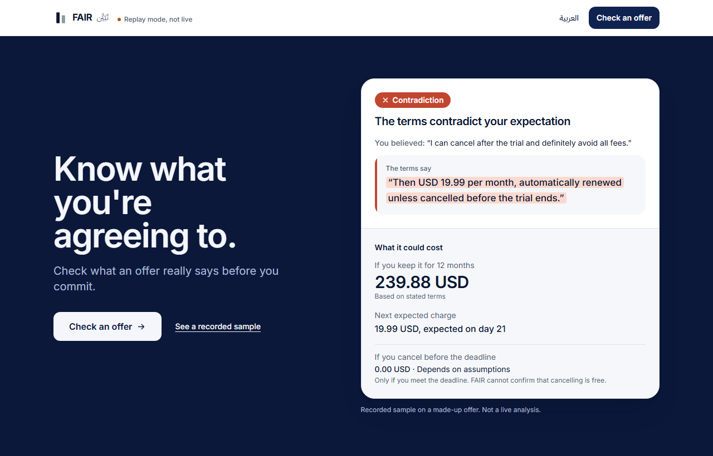
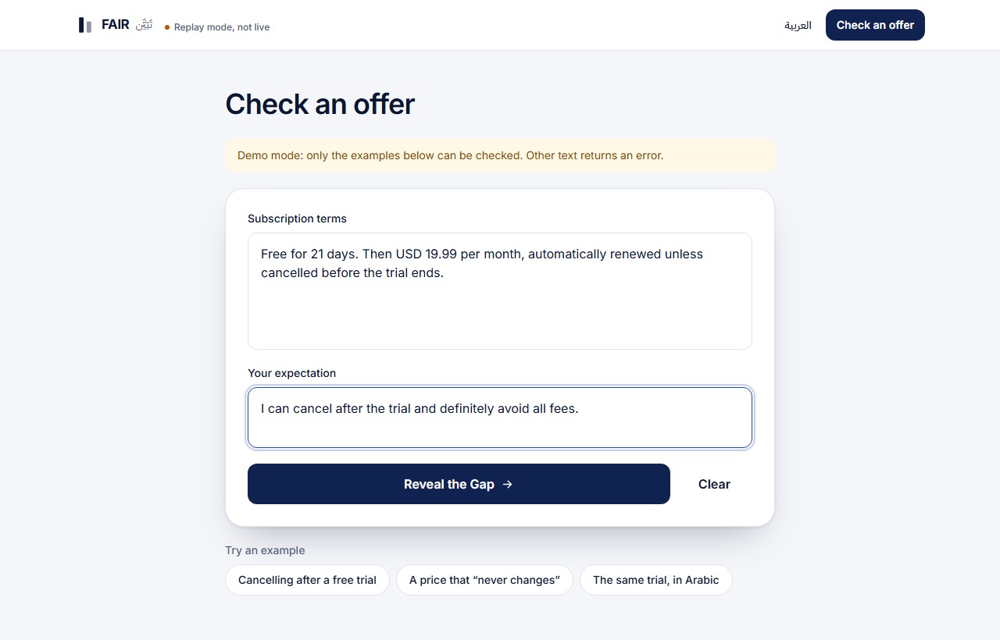
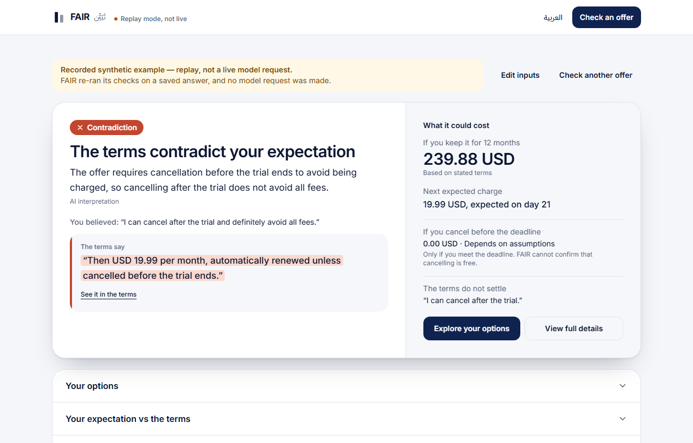
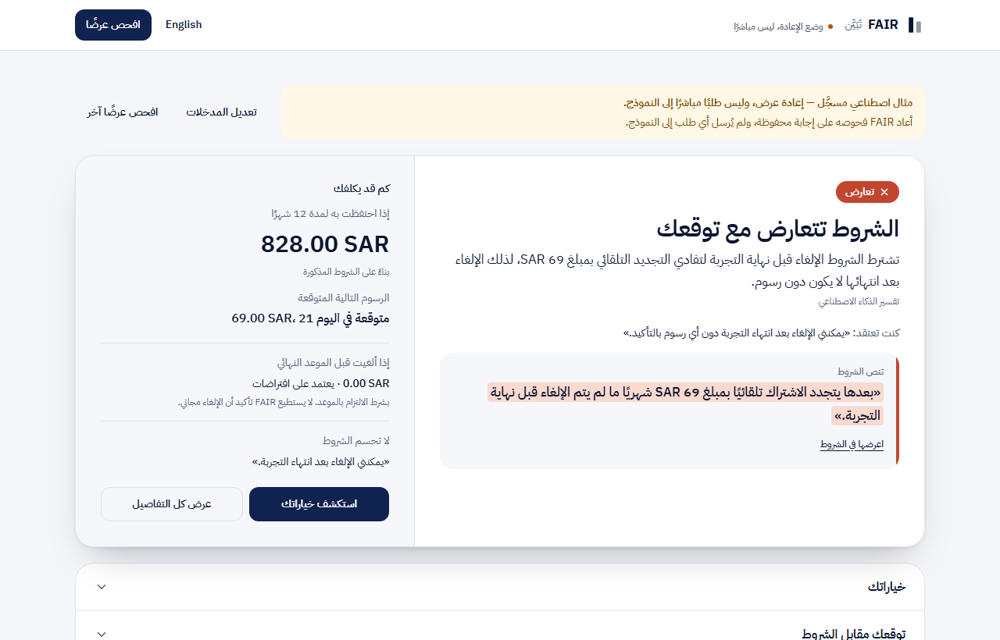

# FAIR · تَبَيَّن — Know what you're agreeing to.

FAIR checks what you *believe* about a subscription offer against what its terms *actually say*, in English or Arabic. You paste the terms, write your expectation, and FAIR shows whether the terms support it, contradict it or leave it open. It quotes the exact sentence behind the verdict and shows what keeping or cancelling would cost.

Muse Spark (`muse-spark-1.3`, via the Meta Model API) does the reading. Deterministic code verifies every quote and does every calculation.

<p align="center">
  
</p>

## Watch the demo

**The demo video has not been published yet.** It will be linked here once it is.

<!-- DEMO VIDEO: replace the line above with the GitHub-hosted video URL on its own line. -->

## Screenshots

| Check an offer | Result (English) | Result (Arabic, right to left) |
|---|---|---|
|  |  |  |

All screenshots come from **replay mode**: real saved Muse Spark outputs, re-checked by FAIR's current code, on synthetic offers. Each one is labelled "Replay mode, not live" in the interface.

## What FAIR does

- **Splits your belief into claims.** Each claim gets its own verdict: MATCH, CONTRADICTION or UNKNOWN (not settled by the terms).
- **Shows its evidence.** A decisive verdict needs a quote found word for word in the terms. Otherwise FAIR shows UNKNOWN.
- **Prices your options.** It compares keeping the subscription with cancelling before the deadline, over 1, 3 and 12 months, using `Decimal` arithmetic on verified values only. Each total is marked as based on stated terms or dependent on assumptions. When the terms are incomplete, FAIR withholds the total and names what is missing.
- **Keeps uncertainty visible.** Assumptions, rejected values and claims the terms don't settle each have their own section, which opens by default whenever there is something to show.
- **Works in English and Arabic,** with a full right-to-left interface. Evidence matching tolerates diacritics and Arabic-Indic digits (٥٩ = 59).

FAIR gives information, not legal or financial advice.

## How it works

```
Browser (React)                    POST /api/analyze {terms, expectation, language}
   │
   ▼
FastAPI backend                    MODEL_API_KEY exists only here
   1. Muse Spark reads the terms   one request, Prompt v5, no retries, 8,000-token output budget
   2. Output treated as untrusted  schema check, verbatim quote matching, claim-level guards
   3. Money checked                currency, price kind and billing period must match the quote
   4. Costs computed in code       Decimal engine; totals withheld when the terms are incomplete
   │
   ▼
Result: verdict, deciding quote, cost paths, assumptions, rejected values
```

A guard can do only three things: downgrade a claim's MATCH or CONTRADICTION to UNKNOWN, reject an extracted value or withhold a total. It never strengthens a verdict or supplies an amount the terms do not state.

## Technology

| Layer | Stack |
|---|---|
| Model | Meta Model API, `muse-spark-1.3` (OpenAI-compatible SDK, Responses API) |
| Backend | Python 3.11, FastAPI 0.162, Pydantic 2, Uvicorn |
| Frontend | React 18.3, Vite 6, Tailwind CSS 3.4; Inter and IBM Plex Sans Arabic fonts |
| Tests | Pytest, Vitest, Testing Library |

## Run locally: replay demo (no API key)

Replay mode serves the built app and answers three synthetic example offers from saved Muse Spark outputs, running FAIR's real checks and cost engine on them. **It cannot contact Meta, and any other input returns an error.**

Requirements: Python 3.11 and Node 20 or newer. The commands below use PowerShell.

```powershell
# 1. Build the frontend
cd frontend
npm ci
npm run build

# 2. Install the backend and start the replay server
cd ..\backend
python -m venv .venv
.venv\Scripts\python.exe -m pip install -r requirements-dev.txt
.venv\Scripts\python.exe -m scripts.demo_replay      # http://127.0.0.1:8010
```

Open http://127.0.0.1:8010 and choose one of the examples under **Try an example**. Add `?lang=ar` to the address to open the Arabic interface. The example inputs are listed in [docs/DEMO_SCRIPT.md](docs/DEMO_SCRIPT.md).

## Configure the real application locally

Live analysis sends each request to the Meta Model API. **Every analysis is a billable request.**

```powershell
# Backend (from backend/)
copy .env.example .env
#   then edit .env:  MODEL_API_KEY=<your key>
#                    MODEL_LIVE_CALLS_ENABLED=true
#                    MODEL_TIMEOUT_SECONDS=90   (recommended; the default is 45)
.venv\Scripts\python.exe -m uvicorn app.main:app --port 8000

# Frontend (from frontend/, in a second terminal)
npm run dev            # http://localhost:5173, forwards /api to port 8000
```

- `backend/.env` is git-ignored. The key is read only by the server. It is never sent to the browser, logged or returned.
- Paid calls stay off unless `MODEL_LIVE_CALLS_ENABLED=true`. Without a key, the app still runs and reports that live AI is not configured. It never returns a made-up result.
- Each analysis makes one request with no automatic retries. The browser waits up to 110 seconds.
- Default protection: 10 analyses per minute per IP and 300 per day per server, with request bodies size-limited. The limits are held in memory, so run a single instance.

All settings are documented in [backend/.env.example](backend/.env.example).

## Testing and evaluation

### Automated tests

These results were checked on the release build, with no model requests: model calls in tests are mocked, and the backend suite blocks network access.

| Check | Result |
|---|---|
| Backend tests (`pytest`) | **1,660 passed** |
| Frontend tests (`vitest`) | **230 passed** |
| Production build (`npm run build`) | Succeeds |
| Release safety scan (`tools/check_release.py`) | No findings |

```powershell
cd backend;  .venv\Scripts\python.exe -m pytest
cd frontend; npm test; npm run build
backend\.venv\Scripts\python.exe tools\check_release.py     # from the repository root
```

### Live end-to-end test

On 3 November 2026, one real request went from the browser interface through the backend to the Meta Model API. It returned in **23.2 seconds** and showed a CONTRADICTION verdict, the same as the model's own answer. The deciding quote matched the terms word for word, and the result was correctly labelled **Live analysis · Model: muse-spark-1.3**. That was a single request. Live latency varies: in earlier live runs, single FAIR requests took 6 to 41 seconds, and one Arabic request exceeded the then 45-second timeout.

### Benchmark (FAIR-Bench v1, synthetic)

| Run (Prompt v5) | Verdicts shown to the user |
|---|---|
| Development | 15/15 |
| Validation, prompt frozen | 15/15 (Arabic 10/10; 36/36 cost totals correct) |

The cases are short and synthetic, the two splits share templates, and the gold labels are author drafts. The prompt was revised after errors on the Development cases. These scores do not measure real-world accuracy.

### Comparison with direct Muse Spark

FAIR was compared once with Muse Spark under a simple neutral prompt. The run used 12 new synthetic cases (5 English, 4 Arabic, 3 mixed) **scored against author-draft labels, not independent ones**. **Direct Muse Spark did better.**

| Measure | FAIR | Direct Muse Spark |
|---|---|---|
| Verdict shown to the user | 9/12 | 11/12 |
| Recurring price correct | 5/12 | 10/12 |
| 12-month total correct | 7/12 | 10/12 |
| False reassurance | 0/7 | 0/7 |
| Unsupported certainty | 2/12 | 3/12 |
| Invented quotes | 0 | 0 |
| Median latency | 14.3 s | 7.2 s |

This run does not show that FAIR is better than using the model directly. FAIR's checks changed one verdict, and that change was wrong. Full per-case results are in [docs/EVALUATION.md](docs/EVALUATION.md), and the method is in [docs/COMPARISON_PROTOCOL.md](docs/COMPARISON_PROTOCOL.md).

## Known limitations

These are unresolved in the current code:

- **Over-cautious money checks.** In the comparison:
  - An offer with two billing options received no answer (CX-04).
  - A required add-on led FAIR to withhold the 12-month total (CX-05).
  - One trial that does not convert showed a total of 0 where none was expected (CX-12).
- **Arabic prices.** In three Arabic cases, the checks rejected a correctly read riyal price (ريالًا), so no total was shown (CX-06, CX-07, CX-09).
- **Conflicting billing statements are not detected.** When the terms state both monthly and yearly billing, FAIR answered CONTRADICTION instead of UNKNOWN (CX-10).
- **Guards can be wrong.** A check downgraded a correct MATCH on a stated 24-month price guarantee (CX-01).
- **Semantic gaps.** A quote can be real and on topic without supporting the claim. That judgment remains the model's, and FAIR labels it "AI interpretation". Offer text is treated as data by instruction, but prompt injection is not ruled out.
- **Totals are partial by design.** FAIR never calculates tax or percentage fees, does not multiply per-seat prices, does not convert weekly billing, and rejects quarterly and daily cycles.
- **Untested ground.** Real-world accuracy and user benefit are unmeasured. FAIR has not been tested on long real terms, and mixed-language quality has been tried on 3 cases only. Every evaluation case ran once per system.
- **Live latency** varies between requests, from about 6 seconds to over 45 seconds.

## Security and project status

- **No secrets in the repository.** The API key lives only in the git-ignored `backend/.env`, and `tools/check_release.py` scans every release file for credentials before publication.
- **Privacy.** In live mode, the text you enter goes to the FAIR server and then to the Meta Model API, where Meta's terms apply. The FAIR server does not store it, and its logs hold only metadata such as verdicts, latency and token counts.
- **Not deployed.** There is no public website for FAIR. It runs locally, as described above, and deployment notes are in [docs/DEPLOYMENT.md](docs/DEPLOYMENT.md).
- **Status:** a hackathon project for the Meta Global AI Developer Hackathon. Raw evaluation runs are kept locally and identified by hash in [docs/EVALUATION.md](docs/EVALUATION.md).
- **License:** none has been chosen yet.

## Repository layout

```
backend/    FastAPI app, tests, evaluation runners, replay server (scripts/demo_replay.py)
frontend/   React app and tests
data/       FAIR-Bench v1 dataset, annotation overlay, data card
docs/       evaluation record, comparison protocol, demo script, deployment, screenshots
tools/      check_release.py, the pre-publication safety scan
```

Fonts are bundled from npm: Inter and IBM Plex Sans Arabic, both under the SIL Open Font License 1.1. The icons and favicon are original inline SVG.
